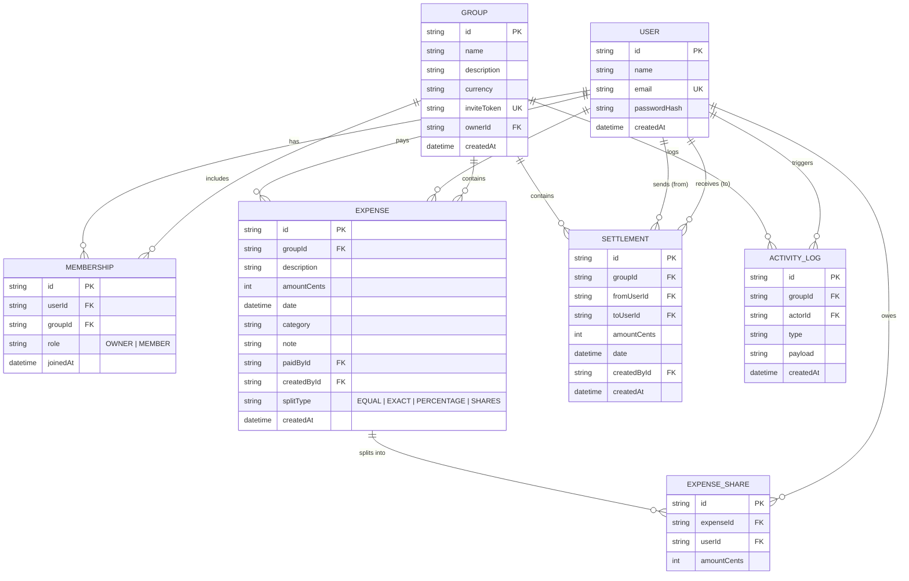

# Tally — Shared Expense Splitting Web App

Tally is a full-featured, production-quality web application designed to help groups (roommates, vacationers, friends, colleagues) seamlessly track shared expenses, view real-time net balances, and settle debts with the absolute minimum number of payments using a greedy debt simplification algorithm.

---

## 🌟 Key Highlights

- **100% Zero-Float Money Architecture**: All financial computations are done strictly with integer cents (`amountCents`) to eliminate floating-point rounding errors.
- **Deterministic Remainder Distribution**: For uneven splits (Equal, Percentage, Shares), leftover cents are distributed deterministically to ensure that the sum of member shares strictly matches the total amount down to 1 cent.
- **Mathematical Zero-Sum Invariant**: Sum of all members' net balances in any group always equals zero (`\sum balance \equiv 0`), verified across hundreds of random property tests.
- **Greedy Debt Simplification**: Solves the Minimum Cash Flow problem, reducing complex group debts to at most $N - 1$ direct transactions.
- **Live Share Preview**: Immediate client-side calculation showing each member's exact cents and remaining balances as you type.
- **End-to-End Server Authorization**: Every mutation and query validates group membership, protecting data from unauthorized access.
- **Multi-Currency Support**: Supports `EUR` (€), `USD` ($), `RSD` (RSD), and `GBP` (£).
- **Responsive & Accessible**: Beautiful UI built with Tailwind CSS, supporting dark/light modes, keyboard navigation, accessible dialogs, and mobile viewports (375px+).

---

## 🚀 Quick Start (Local Setup)

The application runs locally with zero external service dependencies (uses embedded SQLite via Prisma).

### Prerequisites
- Node.js 18+ (tested on Node v22)
- npm 9+

### 1. Install Dependencies
```bash
npm install
```

### 2. Run Database Migrations
```bash
npx prisma migrate dev
```
*(Creates the local SQLite database at `prisma/dev.db` and applies all schema migrations)*

### 3. Seed Demo Data
```bash
npm run seed
```
*(Populates 4 demo users, 2 realistic groups, 30+ expenses across all 4 split types, and settlements)*

### 4. Start Development Server
```bash
npm run dev
```

Open [http://localhost:3000](http://localhost:3000) in your browser.

---

## 🔑 Demo Login Credentials

The seed script creates 4 pre-configured demo users:

| Name | Email | Password |
|---|---|---|
| **Alice Walker** | `alice@example.com` | `password123` |
| **Bob Miller** | `bob@example.com` | `password123` |
| **Charlie Davis** | `charlie@example.com` | `password123` |
| **Diana Prince** | `diana@example.com` | `password123` |

### Pre-loaded Groups
1. **Apartment 4B Roommates** (`EUR`): Monthly rent, fiber internet, electricity, cleaning supplies, and weekly groceries.
2. **Summer Trip to Barcelona** (`EUR`): Holiday apartment, rental SUV, tapas, Sagrada Família, and vineyard wine tasting.

---

## 🏗 Architecture & Data Model

Tally is built with a pure domain logic layer decoupled from Next.js framework handlers, ensuring testability and stability.

```
src/
├── app/                  # Next.js App Router (pages & REST API route handlers)
│   ├── (auth)/           # Login & registration flows
│   ├── (dashboard)/      # Dashboard, groups, expenses, settings, profile
│   ├── api/              # Secure endpoints with Zod & session auth
│   └── invite/[token]/   # Unguessable invite link join flow
├── components/           # Reusable accessible UI components & forms
├── lib/
│   ├── auth/             # Session cookies (jose), bcrypt hashing, rate limiting
│   ├── db/               # Prisma SQLite singleton
│   ├── finance/          # PURE DOMAIN: splits, balances, debt-simplification
│   └── validation/       # Shared client/server Zod schemas
└── types/                # TypeScript interface definitions
```

### Entity-Relationship Diagram (Mermaid)



---

## 🧮 Debt Simplification Algorithm

### Problem Statement
In a group of $N$ people with multiple expenses paid by different members, debts form a directed graph with redundant cycles (e.g., A owes B €20, B owes C €20, C owes A €20). The goal is to settle all balances with the minimum number of transactions.

### The Algorithm (Greedy Minimum Cash Flow)
1. **Compute Net Balances**:
   For every member $u$, calculate:
   $$\text{Balance}(u) = \text{Total Paid} - \text{Total Share} + \text{Settled Sent} - \text{Settled Received}$$
   Members with $\text{Balance} > 0$ are **creditors** (owed money).
   Members with $\text{Balance} < 0$ are **debtors** (owe money).
   Members with $\text{Balance} = 0$ are ignored.
2. **Greedy Matching**:
   - In each iteration, sort debtors descending by amount owed and creditors descending by amount owed to them.
   - Pair the **largest debtor** ($D$) with the **largest creditor** ($C$).
   - Execute a settlement payment of $M = \min(\text{amountOwed}(D), \text{amountCredit}(C))$.
   - Decrement $D$'s debt and $C$'s credit by $M$.
   - Remove any member whose balance reaches $0$.
3. **Termination & Complexity**:
   - Each step zeroes out at least one member's balance.
   - The loop runs in at most $N - 1$ steps, producing at most $N - 1$ transactions.
   - Time complexity: $O(N \log N)$ where $N$ is the number of active group members.

---

## 🧪 Testing Suite

### 1. Unit Tests (Vitest)
Tests pure mathematical logic:
- Equal, Exact, Percentage, and Shares splits with uneven remainder cents.
- Balance calculations from mixed expenses and settlements.
- **Zero-Sum Balance Invariant**: Generates 200 random simulated groups and asserts $\sum \text{balances} \equiv 0$ in all cases.
- Greedy debt simplification correctness and payment counts.

```bash
npm run test
```

### 2. End-to-End Tests (Playwright)
Validates complete user flows and security boundaries:
- Registration $\rightarrow$ Group Creation $\rightarrow$ Invite Link Sharing $\rightarrow$ User B Registration & Join $\rightarrow$ Uneven Split Expense $\rightarrow$ Live Balance Verification $\rightarrow$ Settle Up $\rightarrow$ "Settled Up" Verification.
- **Permission Isolation**: Proves that non-members cannot read, mutate, or delete private group data (HTTP 403 enforcement).

```bash
npm run test:e2e
```

---

## 🔒 Security Measures

- **Password Security**: Passwords hashed with `bcryptjs` (salt rounds: 10). Plaintext passwords are never stored or logged.
- **Session Protection**: HTTP-only, SameSite=Lax signed session cookies with 7-day expiration.
- **Rate Limiting**: In-memory rate limiting on `/api/auth/login` to prevent brute force credential stuffing.
- **Zero Balance Enforcement**: Members can only leave or be removed if their group balance is exactly zero (€0.00).

---

## 📝 Known Limitations & Future Enhancements

- **In-Memory Rate Limiting**: The current rate limiter runs in process memory. For horizontally-scaled serverless deployments (e.g. multiple Vercel Lambda instances), an external store such as Redis/Upstash is recommended.
- **Recurring Expenses**: Currently expenses are logged on single dates; support for automated recurring bills (e.g. monthly rent) could be added in a future update.
- **Multi-Currency Conversion**: Each group operates in a single currency (EUR, USD, RSD, or GBP). Future iterations could support automatic FX rate conversion between mixed currencies within one group.
